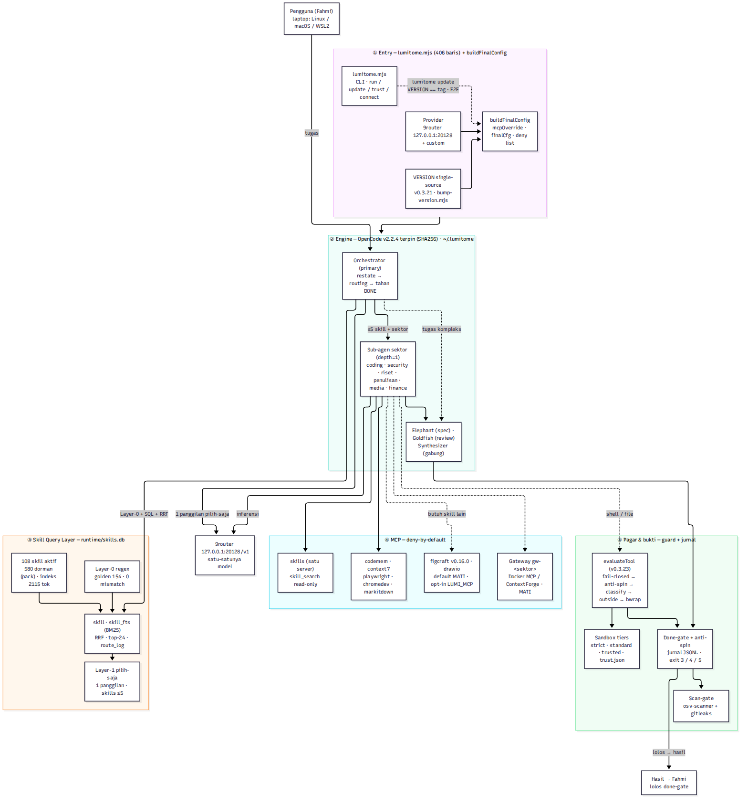
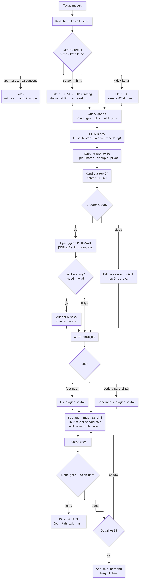

# Arsitektur Final Swanwright v0.1.6

Target: **OpenCode v2.2.4** (rilis GitHub anomalyco/opencode). Model hanya via **9router**. 108 skill aktif (tidak dipotong/ditambah); `api-security` & `llm-security` tetap nonaktif (pack red-team).
Diagram: `docs/diagrams/arsitektur-final.png` (sistem) · `docs/diagrams/orchestrator-final.png` (alur orchestrator). Sumber Mermaid di sebelahnya.

## 1. Lapisan

| # | Lapisan | Path | Inti |
|---|---|---|---|
| ① | Pemasangan | `install.sh`, `scripts/doctor.sh` | OpenCode v2.2.4 / Node 22.23.4 / codebase-memory-mcp v0.12.1 / uv 0.13.6 — SHA256 terpin **dan** cocok file checksum rilis; ke `~/.swanwright`; idempoten; tidak menyentuh `~/.config/opencode` |
| ② | OpenCode + `.opencode/` | `opencode.jsonc`, `.opencode/agents`, `rules`, `plugins`, `skills` | Orchestrator (primary) → sub-agen sektor (depth=1) → Elephant/Goldfish/Synthesizer. Code Mode v2 tetap aktif |
| ③ | Skill Query Layer | `router/skill-db.mjs`, `scripts/skill-index.mjs`, `scripts/skill-query.mjs`, `router/skill-search-mcp.mjs`, `runtime/skills.db` | SQLite FTS5 BM25 (+sqlite-vec opsional), filter SQL sebelum ranking, RRF, dedup, top-24, 1 panggilan 9router pilih-saja ≤5, `route_log` |
| ④ | MCP per sektor | `router/mcp-sectors.json`, `scripts/gen-policy.mjs`, `docs/MCP.md`, `docs/MCP-GATEWAY.md`, `config/mcp-gateway/` | deny-by-default `*_*` → allow server sektor sendiri; gateway opsional (mati) |
| ⑤ | Pagar & bukti | `harness/done-gate.ts`, `harness/scan-gate.ts`, `harness/sandbox/`, `.opencode/plugins/swanwright.ts` | FACT/JUDGMENT, osv-scanner v2.7.0 + gitleaks v8.30.1, bwrap, blok push main/master + blok `codebase-memory-mcp install/update` |

## 2. Skill Query Layer (desain v0.2, fase 1)
Alur (`route()` di `router/skill-db.mjs`):
1. **Layer-0 regex** (`router/layer0-regex.mjs`, tidak diubah; golden 154, 0 mismatch) → sektor + hint + consent.
2. **Filter SQL keras sebelum ranking**: `status='active'`, `pack IS NULL` (kecuali pack diaktifkan), sektor via `allowed_skill` (allowlist agent sektor = registry.sektor + hint Layer-0 lintas sektor), kecualikan `skill_edge kind='duplicate'`.
3. **Query ganda deterministik**: q0 = tugas, q1 = hint Layer-0 → tetap 1 panggilan LLM.
4. **FTS5 BM25** (bobot kolom name 8 · triggers 4 · short 2 · description 1) + daftar hint + **sqlite-vec** bila embedding tersedia (`SW_EMBED_MODEL` lewat 9router `/embeddings`; `SW_EMBED=hash` = n-gram leksikal untuk uji). Tanpa embedding → **BM25-only** (default).
5. **RRF** k=60, pin `$nama`/`skill:nama`, top-N=24 (dijepit 16–32).
6. **Layer-1 pilih-saja** (`router/layer1-select.md`): 1 panggilan 9router, JSON `{sectors, skills≤5, confidence, need_more}`, divalidasi ⊆ kandidat. Deskripsi kandidat disanitasi (≤200–300 char, tanpa URL/markup). 9router mati → fallback deterministik top-5.
7. **route_log** (SQLite) dicatat tiap routing; dipertahankan saat indeks dibangun ulang.
8. **skill_search** (MCP stdio, read-only, DB `readOnly`) — satu server `skills` untuk semua sektor (sejak v0.3.13), hanya allowlist sektor itu.
9. **Rebuild**: `scripts/skill-index.mjs --if-changed` — hash = SHA-256(registry + layer0 + tiap SKILL.md + status + provider embed + versi skema).

Metrik (`npm run skills:metrics`, golden 154, 96 kasus punya gold skill, tanpa L1, BM25-only, diukur di box 31 Okt 2026):
top-1 **0,7813** · recall@5 (any) **0,9167** · recall@5 (fraksi) **0,8264** · candidate-recall@16/@32 **0,9167** · MRR **0,842** · zero-load **0** · retrieval p50 **0,31 ms** / p95 **0,76 ms**. Dengan `SW_EMBED=hash`: recall@5 0,9167, cand@32 1,0, top-1 0,7292.
Catatan jujur: golden berisi banyak prompt templat berulang ("kasus N") → angka optimistis; miss utama "cek CVE dependency" (tanpa hit Layer-0) tidak menemukan `security-audit`.

## 3. MCP per sektor
| Sektor | Server (selain `skills`, `gw-<sektor>`) |
|---|---|
| coding | context7, codemem, github (mati), playwright, chromedev |
| media (design/web) | figma (mati, OAuth), playwright, chromedev |
| riset | context7, markitdown, playwright |
| penulisan | context7, markitdown |
| security (defensif) | context7, codemem |
| finance (tanpa trading) | markitdown |
| elephant / goldfish | context7+codemem / codemem |
| orchestrator / synthesizer | — |
Rincian, pin versi, dan alasan: `docs/MCP.md`. Gateway: `docs/MCP-GATEWAY.md`.

## 4. Orchestrator

## 5. Invarian (dicek `npm test` / `npm run validate`)
- Tepat 108 skill aktif; api-security/llm-security tidak aktif; golden 154 L0 0 mismatch.
- `opencode.jsonc` lolos skema resmi (ajv 2020) + native V2 + kebijakan MCP (`checkMcpPolicy`).
- Frontmatter agent = keluaran `gen-policy` (tidak boleh basi).
- Plugin v2 `export default {id, setup}`; push main/master & cbm install diblok.
- Versi single-source (v0.3.21): file `VERSION` satu-satunya tempat versi ditulis; `lumitome/bin/lumitome.mjs` + `install.sh` membacanya saat jalan; `node scripts/bump-version.mjs <x.y.z> ["judul"]` menyinkronkan `package.json`/lockfile/README/CHANGELOG + verifikasi. Tes konsistensi membaca `VERSION` (tanpa hardcode) dan menjalankan `--version` asli.
- Indeks skill single-source (v0.3.21): `router/skills-index.md` dibangkitkan `scripts/gen-registry.mjs` dari registry (per sektor, alfabetis) — jangan edit manual; `--check` memverifikasi kesegarannya.
- Scan-gate: osv-scanner + gitleaks PASS.

## 6. Sandbox: tier kepercayaan (v0.3.19)
Kebijakan dirakit per sesi oleh `buildSandboxScope` (`harness/lumi-guard.mjs`), ditegakkan plugin `lumitome/config/plugins/lumitome-guard.ts` (hook `tool.execute.before`, fail-closed bila guard gagal dimuat).
- **Tier** (dipilih manusia, bukan agent): `strict` = tulis folder kerja + bwrap, fail-closed bila bubblewrap tidak ada; `standard` = default, aturan tulis sama, guard saja tanpa bwrap; `trusted` = tulis selebar akar proyek, guard saja. Sumber tier: env `LUMI_TRUST_TIER` (menang) lalu `~/.lumitome/trust.json` (kunci = akar proyek, bentuk `{"projects": {"<root>": "trusted"}}` atau `{"tier": ..., "write": [...]}`); tanpa keduanya → `standard`. File trust hidup di luar workspace dan di-mask dari agent — agent tidak bisa membaca/mengubah tier-nya sendiri. `lumitome trust` menampilkan tier + cakupan tulis + aturan SSH; `lumitome trust <tier>` mengaturnya untuk proyek ini.
- **Akar proyek**: jalan ke atas maks 5 tingkat dari folder sesi untuk `.git`, `opencode.jsonc`, `MEMORY.md`, `.lumitome`; tidak melewati `$HOME`; marker di `$HOME` sendiri diabaikan. Perhitungan path murni, tidak membaca config — v0.3.16 menghapus deteksi akar + `sandbox.json` karena config-nya hidup di dalam workspace; v0.3.19 mengembalikan deteksi saja, trust disimpan di luar workspace.
- **MEMORY.md ancestor**: file `MEMORY.md` di folder induk (maks 5 tingkat) bisa ditulis sebagai file, tanpa membuka seluruh folder induk.
- **Kinerja**: pemindaian file rahasia (`findSecrets`) di-cache per proses (TTL 5 menit) — perintah shell pertama membayar jalan kaki penuh, berikutnya ~0,6 ms (diukur: 4,2 detik → 0,6 ms/perintah di VM build; sebelumnya ~866 ms per perintah).
- **SSH deploy**: tier standard/strict mengizinkan `ssh`/`scp`/`sftp` hanya dengan `-i` kunci deploy di bawah `~/.lumitome/` (dibuat via `lumitome trust --deploy-key [nama]`, bukan `id_*`, bukan `~/.ssh/`); tier trusted membebaskan ssh; `ForwardAgent` hanya di trusted. `sudo` lokal ditolak di semua tier; `sudo` di VPS tidak diatur sandbox (berjalan di server).
- **Transparansi**: wrapper mencetak tier + cakupan tulis saat sesi dimulai; plugin mencatat tier/root/write ke jurnal.
