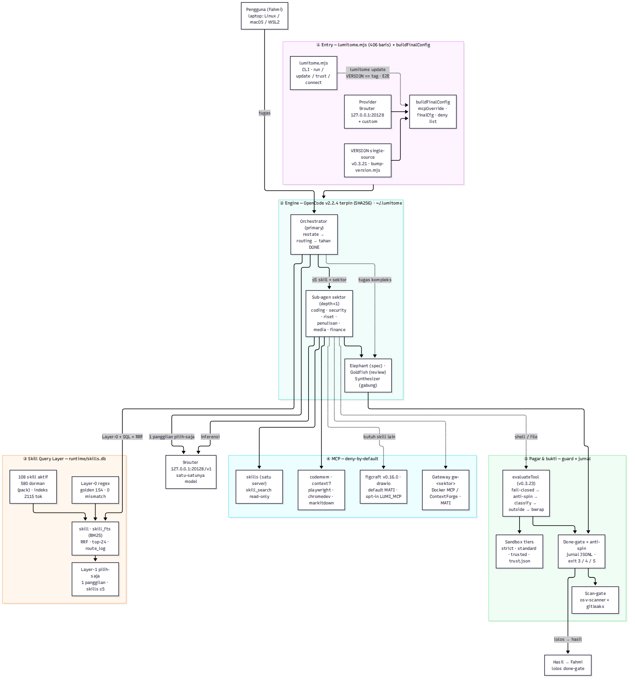
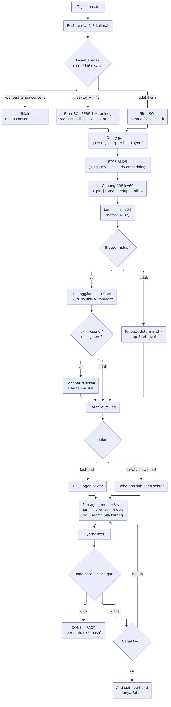

# Arsitektur Lumitome v0.3.72

Target: **OpenCode v2.3.0** (rilis GitHub anomalyco/opencode). Model hanya via **9router**. 929 skill di satu registry (763 bisa ter-route; 166 pack red-team tetap disabled, termasuk `api-security` & `llm-security`). Sejak v0.3.27 (satu korpus): tidak ada lagi pack nonaktif/dorman. Dokumen ini diperbarui di v0.3.77 agar cocok dengan kode v0.3.77 (tambah skill + MCP platformio; koreksi era v0.3.57 diverifikasi ulang dari kode + CHANGELOG, bukan dari dokumen lama).
Diagram: `docs/diagrams/arsitektur-final.png` (sistem) · `docs/diagrams/orchestrator-final.png` (alur orchestrator). Sumber Mermaid di sebelahnya.

## 1. Lapisan

| # | Lapisan | Path | Inti |
|---|---|---|---|
| ① | Pemasangan | `install.sh`, `scripts/doctor.sh` | OpenCode v2.3.0 / Node 22.23.4 / codebase-memory-mcp v0.12.1 / uv 0.13.6 — SHA256 terpin **dan** cocok file checksum rilis; ke `~/.swanwright`; idempoten; tidak menyentuh `~/.config/opencode`; engine di-upgrade via `lumitome upgrade` (v0.3.66, tanpa argumen versi/hash) |
| ② | OpenCode + `.opencode/` | `opencode.jsonc`, `.opencode/agents`, `rules`, `plugins`, `skills` | Orchestrator (primary) → sub-agen sektor (depth=1) → Elephant/Goldfish/Synthesizer; + 4 agen peran /subagent (Thinking/Search/Build/Review, §7). Code Mode v2 tetap aktif |
| ③ | Skill Query Layer | `router/skill-db.mjs`, `scripts/skill-index.mjs`, `scripts/skill-query.mjs`, `router/skill-search-mcp.mjs`, `runtime/skills.db` | SQLite FTS5 BM25 (+sqlite-vec opsional), filter SQL sebelum ranking, RRF, dedup, top-24, 1 panggilan 9router pilih-saja ≤5, `route_log` |
| ④ | MCP per sektor | `router/mcp-sectors.json`, `scripts/gen-policy.mjs`, `docs/MCP.md`, `docs/MCP-GATEWAY.md`, `config/mcp-gateway/` | deny-by-default `*_*` → allow server sektor sendiri; gateway opsional (mati) |
| ⑤ | Pagar & bukti | `harness/done-gate.ts`, `harness/scan-gate.ts`, `harness/sandbox/`, `.opencode/plugins/swanwright.ts`, `lumitome/config/plugins/lumitome-guard.ts` | FACT/JUDGMENT, osv-scanner v2.7.0 + gitleaks v8.30.1, sandbox mati default (bwrap hanya bila `LUMI_SANDBOX=bwrap`, §6), blok push main/master + blok `codebase-memory-mcp install/update` |

## 2. Skill Query Layer (desain v0.2, fase 1)
Alur (`route()` di `router/skill-db.mjs`):
1. **Layer-0 regex** (`router/layer0-regex.mjs`, tidak diubah; golden 154, 0 mismatch) → sektor + hint + consent.
2. **Filter SQL keras sebelum ranking**: `status='active'` (pack red-team = `disabled`; tidak ada lagi filter pack), sektor via `allowed_skill` (allowlist agent sektor = registry.sektor + hint Layer-0 lintas sektor), kecualikan `skill_edge kind='duplicate'`.
3. **Query ganda deterministik**: q0 = tugas, q1 = hint Layer-0 → tetap 1 panggilan LLM.
4. **FTS5 BM25** (bobot kolom name 8 · triggers 4 · short 2 · description 1) + daftar hint + **sqlite-vec** bila embedding tersedia (`SW_EMBED_MODEL` lewat 9router `/embeddings`; `SW_EMBED=hash` = n-gram leksikal untuk uji). Tanpa embedding → **BM25-only** (default).
5. **RRF** k=60, pin `$nama`/`skill:nama`, top-N=24 (dijepit 16–32).
6. **Layer-1 pilih-saja** (`router/layer1-select.md`): 1 panggilan 9router, JSON `{sectors, skills≤5, confidence, need_more}`, divalidasi ⊆ kandidat. Deskripsi kandidat disanitasi (≤200–300 char, tanpa URL/markup). 9router mati → fallback deterministik top-5.
7. **route_log** (SQLite) dicatat tiap routing; dipertahankan saat indeks dibangun ulang.
8. **skill_search** (MCP stdio, read-only, DB `readOnly`) — satu server `skills` untuk semua sektor (sejak v0.3.13), hanya allowlist sektor itu.
9. **Rebuild**: `scripts/skill-index.mjs --if-changed` — hash = SHA-256(registry + layer0 + tiap SKILL.md + status + provider embed + versi skema).

Metrik (`npm run skills:metrics`, golden 154, 112 kasus punya gold skill, tanpa L1, BM25-only; baseline v0.3.26: 96 kasus, top-1 0,7396, recall@5 0,9167):
top-1 **0,8304** · recall@5 (any) **1,0** · recall@5 (fraksi) **0,8255** · candidate-recall@16/@32 **1,0** · MRR **0,9152** · zero-load **0** · retrieval p50 **~1–2 ms** / p95 **~4–5 ms** (v0.3.71, katalog 762 — sama dengan v0.3.46 kecuali latensi yang ber-noise antar-run; angka berjalan di `runtime/metrics.json`, dibangkitkan perintah yang sama). Sebelum tuning v0.3.46: top-1 0,7946, MRR 0,8973, recall@5 1,0. Trial lepas-dorman 8 Nov 2026 (katalog 624 — angka HISTORIS, katalog saat itu lebih kecil, BM25-only tanpa L1) sempat top-1 0,6696 / recall@5 0,7857 / MRR 0,7277 — regresi vs baseline = dilusi katalog 110 → 624 skill; tuning 3 putaran + v0.3.33 + v0.3.46 mengembalikannya.
Catatan jujur: golden berisi banyak prompt templat berulang ("kasus N") → angka optimistis; held-out 24 kasus prompt natural (`tests/golden-routing-heldout.json`, TIDAK dipakai saat tuning) v0.3.71 (sama dengan v0.3.46): top-1 0,8333, recall@5 1,0, MRR 0,9028 (sebelum tuning: top-1 0,6667, recall@5 0,9583, MRR 0,7847, 1 miss). Miss lama "cek CVE dependency" (tanpa hit Layer-0) lunas di v0.3.46: 6/6 kasus keamanan held-out kini top-1 `security-audit`.

## 3. MCP per sektor
| Sektor | Server (selain `skills`, `gw-<sektor>`) |
|---|---|
| coding | context7, codemem, github (mati), playwright, chromedev |
| media (design/web) | figma (mati, OAuth), stitch (mati), figcraft (mati), blender (mati), playwright, chromedev |
| riset | context7, markitdown, playwright, parallel (mati) |
| penulisan | context7, markitdown, drawio (mati) |
| security (defensif) | context7, codemem |
| finance (tanpa trading) | markitdown |
| elephant / goldfish | context7+codemem / codemem |
| orchestrator / synthesizer | — |
Rincian, pin versi, dan alasan: `docs/MCP.md`. Gateway: `docs/MCP-GATEWAY.md`. Semua server bertanda (mati) = OFF by default, dinyalakan eksplisit lewat `LUMI_MCP`.

## 4. Orchestrator

Design loop (v0.3.26): tugas desain tidak selesai di kode — `/loopdesign [N]` menjalankan skill `loopdesign` (pre-mortem 3 jebakan AI-slop sebelum coding, komponen nyata dari `design-assets`) dalam loop render → `harness/design-gate.mjs` ukur (viewport 1440/768/390, kontras ≥4,5:1, tap target ≥44px) → kritikus sub-agent terpisah menyerang dari screenshot + metrik saja → Maker perbaiki; orchestrator menahan DONE sampai Design-Gate lolos, dan loop berhenti bila gate lolos, tanpa perbaikan, N habis, atau 3 iterasi gagal berturut-turut. v0.3.31: Maker juga mendeklarasikan kontrak interaksi di `DESIGN.md` (blok `behavior-contract`) yang dijalankan tiap iterasi sebagai behavior gate (`harness/design-behavior.mjs`, probe CDP terskrip — findings `behavior`/`probe-gagal` ikut memvonis; probe gagal = finding, bukan crash); findings token-fidelity menyebut nama variabel CSS + saran ganti dan netral wajib tint token; gambar gagal di browser dicek HTTP dulu (200 + byte gambar valid = warn, bukan fail); kritikus membandingkan pairwise iterasi sekarang vs sebelumnya dalam dua urutan presentasi (`harness/design-pairwise.mjs` — checklist biner + DOM bbox/computed styles + screenshot, MENGINFORMASIKAN, never-gate); findings tak berkurang 2 iterasi berturut-turut → berhenti dengan vonis "mentok di N findings" (state di `<workspace>/.tmp/loopdesign/loop-history.jsonl`). v0.3.55: langkah Maker berkonsultasi ke modern-web-guidance lewat `harness/mwg-consult.mjs` (konsultasi runtime, BUKAN skill impor; gagal → fallback). Delegasi ke agen peran diatur §7.

## 5. Invarian (dicek `npm test` / `npm run validate`)
- 929 skill di satu registry (763 bisa ter-route, 166 red-team disabled); api-security/llm-security tidak aktif; golden 154 L0 0 mismatch.
- `opencode.jsonc` lolos skema resmi (ajv 2020) + native V2 + kebijakan MCP (`checkMcpPolicy`).
- Frontmatter agent = keluaran `gen-policy` (tidak boleh basi).
- Plugin v2 `export default {id, setup}`; push main/master & cbm install diblok.
- Versi single-source (v0.3.21, ditegakkan validate sejak v0.3.47): file `VERSION` satu-satunya tempat versi ditulis; `lumitome/bin/lumitome.mjs` + `install.sh` membacanya saat jalan; `node scripts/bump-version.mjs <x.y.z> ["judul"]` menyinkronkan `package.json`/lockfile/README/CHANGELOG + verifikasi; `scripts/version-check.mjs` (dipakai `npm run validate`) gagal bila VERSION vs package.json vs README (badge + tarball) vs CHANGELOG tidak cocok, atau entri CHANGELOG masih placeholder TODO. Tes konsistensi membaca `VERSION` (tanpa hardcode) dan menjalankan `--version` asli.
- Hitungan skill aktif dinamis (v0.3.47): `validate` membandingkan folder skill aktif dengan entri aktif registry — tanpa hardcode 127 (pelajaran v0.3.20 untuk pack kini berlaku juga untuk aktif); skill aktif ke-128 lolos bila folder + registry + indeks sinkron, gagal bila ada yang ketinggalan (tes e2e di suite).
- Indeks skill single-source (v0.3.21): `router/skills-index.md` dibangkitkan `scripts/gen-registry.mjs` dari registry (per sektor, alfabetis) — jangan edit manual; `--check` memverifikasi kesegarannya.
- Scan-gate: osv-scanner + gitleaks PASS.
- Preset /subagent (v0.3.71): file user `$LUMI_HOME/lumitome-subagent.json` sumber kebenaran; file repo hanya seed; `DEFAULT_MODEL` satu sumber (`lumitome/lib/default-model.mjs`).
- Sandbox mati default (v0.3.71): bwrap hanya bila `LUMI_SANDBOX=bwrap`; `external_directory` allow eksplisit sesudah `*_*` deny.
- Mode auto default (v0.3.51; opt-out `LUMI_AUTO_MODE=0` / `--no-auto`); lint gate fail-closed di validate (v0.3.54).

## 6. Sandbox: mati default (v0.3.71)
Sandbox (bwrap) HANYA bila `LUMI_SANDBOX=bwrap` eksplisit; default off sejak v0.3.71 (permintaan Fahmi: seperti OpenCode biasa, mode auto tetap default). Tier strict TIDAK lagi memaksa bwrap. `external_directory` diubah ask → allow (BUKAN dihapus — menghapusnya membuat aturan `*_*` deny menelan external_directory karena aturan terakhir yang cocok menang; terbukti live 0371).
Kebijakan dirakit per sesi oleh `buildSandboxScope` (`harness/lumi-guard.mjs`), ditegakkan plugin `lumitome/config/plugins/lumitome-guard.ts` (hook `tool.execute.before`, fail-closed bila guard gagal dimuat). Tier tetap dibaca (env `LUMI_TRUST_TIER` menang, lalu `~/.lumitome/trust.json`) dan scope object tetap dirakit — tapi cek scope (`evaluateTool` langkah 5) hanya jalan bila sandbox non-null; bila off, cek scope dilewati.
- **Tier** (dipilih manusia, bukan agent): `strict` = tulis folder kerja; `standard` = default, aturan tulis sama; `trusted` = tulis selebar akar proyek. Tanpa bwrap, tier strict tidak lagi memaksa isolasi proses; fail-closed bila bubblewrap tidak ada hanya berlaku bila `LUMI_SANDBOX=bwrap` diminta dan bwrap tidak tersedia (`SANDBOX_CLOSED`). Sumber tier: env `LUMI_TRUST_TIER` (menang) lalu `~/.lumitome/trust.json` (kunci = akar proyek, bentuk `{"projects": {"<root>": "trusted"}}` atau `{"tier": ..., "write": [...]}`); tanpa keduanya → `standard`. `resolveTrustTierDetailed` mengembalikan sumbernya (`env`/`file`/`default`); bila dari env, wrapper memperingatkan di stderr + mencatat `tier-env` di jurnal, dan `lumitome trust` menampilkan sumbernya. File trust hidup di luar workspace dan di-mask dari agent — agent tidak bisa membaca/mengubah tier-nya sendiri. `lumitome trust` menampilkan tier + cakupan tulis + aturan SSH; `lumitome trust <tier>` mengaturnya untuk proyek ini.
- **Akar proyek**: jalan ke atas maks 5 tingkat dari folder sesi untuk `.git`, `opencode.jsonc`, `MEMORY.md`, `.lumitome`; tidak melewati `$HOME`; marker di `$HOME` sendiri diabaikan. Perhitungan path murni, tidak membaca config — v0.3.16 menghapus deteksi akar + `sandbox.json` karena config-nya hidup di dalam workspace; v0.3.19 mengembalikan deteksi saja, trust disimpan di luar workspace.
- **MEMORY.md ancestor**: file `MEMORY.md` di folder induk (maks 5 tingkat) bisa ditulis sebagai file, tanpa membuka seluruh folder induk.
- **Kinerja**: pemindaian file rahasia (`findSecrets`) di-cache per proses (TTL 5 menit) — perintah shell pertama membayar jalan kaki penuh, berikutnya ~0,6 ms (diukur: 4,2 detik → 0,6 ms/perintah di VM build; sebelumnya ~866 ms per perintah).
- **SSH deploy**: tier standard/strict mengizinkan `ssh`/`scp`/`sftp` hanya dengan `-i` kunci deploy di bawah `~/.lumitome/` (dibuat via `lumitome trust --deploy-key [nama]`, bukan `id_*`, bukan `~/.ssh/`); tier trusted membebaskan ssh; `ForwardAgent` hanya di trusted. `sudo` lokal ditolak di semua tier; `sudo` di VPS tidak diatur sandbox (berjalan di server).
- **Yang tetap berlaku saat sandbox off**: deny rahasia (.env, .ssh, kunci), deny perintah destruktif (rm -rf, sudo, git push --force/main), MCP deny-by-default, anti-spin, jurnal. Trade-off jujur: lebih leluasa, lebih sedikit pengaman terhadap perintah destruktif.
- **Transparansi**: startup diam secara default (v0.3.25) — wrapper tidak mencetak tier saat sesi dimulai dan baris status service engine ("Starting background server...") disaring dari stderr TUI; tier + cakupan tulis bisa dilihat lewat `lumitome trust` atau `LUMI_VERBOSE=1`, dan plugin tetap mencatat tier/root/write ke jurnal. Pengecualian visibilitas (v0.3.43, P1-2): `LUMI_TRUST_PROJECT=1` wajib dikonfirmasi `ya` tiap sesi di terminal (non-TTY: peringatan keras + jurnal, tanpa persetujuan permanen); tier dari env selalu diperingatkan + dicatat di jurnal; tool di luar daftar guard (MCP, webfetch, sub-agent) dicatat `unguarded` di jurnal (tidak diblokir); `LUMI_HARNESS` hanya di bawah `~/.lumitome/` (atau modul guard bawaan), di luar itu guard tertutup (`LUMI_GUARD_CLOSED`).

## 7. Subagent (/subagent, v0.3.61–v0.3.71)
Empat peran — Thinking, Search, Build, Review — SELALU aktif (tidak ada saklar per-peran); saklar global `/subagent on|off` tetap ada, toast persis `Subagent ON` / `Subagent OFF`. Hanya Thinking (fase rencana) + orchestrator boleh bertanya ke user; Search/Build yang mentok melapor `BLOCKED` ke orchestrator. Sistem dormant by default: popup hanya bila `/subagent` dipanggil eksplisit.
- **Preset (v0.3.71, A1–A4):** sumber kebenaran preset pindah ke `$LUMI_HOME/lumitome-subagent.json` (tidak ter-track, tidak disentuh update); file repo `.opencode/lumitome-subagent.json` jadi SEED default saja; accessor tunggal `lumitome/lib/subagent-preset.mjs` (migrasi sekali, fallback ke seed bila file user hilang/rusak). `lumitome update` mempertahankan preset saat swap git-mode, rollback, dan mode npm (A1b). Keputusan Thinking-vs-default satu tempat (`resolveSessionDefault`, A2) — kegagalan TUI_MODEL bersuara SELALU (stderr tanpa syarat `LUMI_DEBUG`, v0.3.76) + alasan di `subagent-preset status`, bukan fallback diam-diam ke gemini. Satu konstanta `DEFAULT_MODEL` (`lumitome/lib/default-model.mjs`, A3); kedua `opencode.jsonc` tetap literal + komentar penanda sumber tunggal. Wrapper menyinkronkan file agent `.opencode/agents/{role}.md` dari preset user SEBELUM engine start (A4) — engine memuat definisi agent saat startup dan tidak membaca ulang sesudah popup save; tanpa ini sesi anak tetap memakai model file agent, bukan preset. Perubahan preset tengah sesi berlaku untuk sesi anak yang dibuat sesudahnya (plugin server mengalihkan modelnya ke preset, v0.3.76); TUI baru sesudah ganti preset tidak me-reuse daemon basi (sidik service ikut menghitung preset + baris `model:` file agent, v0.3.76). Preset yang sudah terhapus sebelum v0.3.71 tidak pulih otomatis.
- **Penegakan native (v0.3.70):** delegasi ditegakkan di KODE plugin server `lumitome.subagent` (`lumitome/config/plugins/subagent/`), bukan diminta lewat instruksi `.md`. Context hook menghapus semua tool kecuali allowlist `[subagent, question, read, glob, grep]` di tiap panggilan model saat ON + agent orchestrator; guard `execute.before` menolak tool mutasi dari orchestrator + memvalidasi panggilan subagent (agent harus salah satu dari 4 peran); protokol delegasi pendek diinjeksikan tiap panggilan model. TIDAK ada wrapper tool `delegate` (tool subagent bawaan sudah ada) dan TIDAK ada re-drive (OpenCode 2.3.0 tidak punya hook Stop/SubagentStop yang bisa memblokir) — plugin hanya mengukur: `$LUMI_HOME/subagent-metrics.jsonl` (`node scripts/subagent-metrics.mjs` meringkas delegation-rate).
- **Batasan jujur:** penegakan live baru terverifikasi di engine 2.3.0 (VM). Isu terbuka (15 Nov 2026): Kritikus loopdesign (agent `reviewer`) sempat mengira dirinya orchestrator dan meminta mode /subagent dimatikan — akar: `reviewer.md` menanam identitas "pemeriksa peran /subagent" + `criticInput()` tak pernah dipanggil kode produksi + state machine loop hanya prosa. Rencana P0–P2 (bersihkan identitas /subagent dari `reviewer.md`, driver paket kritikus, eval role-fidelity) BELUM diimplementasi saat dokumen ini ditulis.
