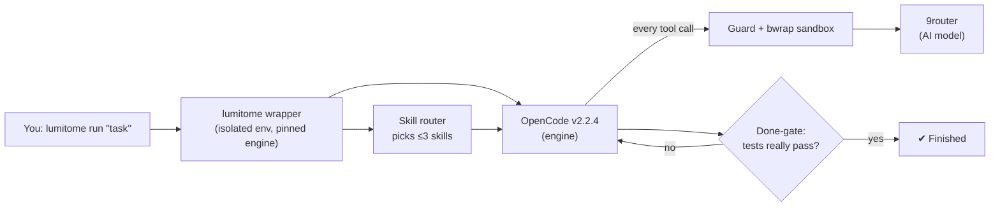

<div align="center">


<br/>


# Lumitome

**A safe-by-default AI coding CLI, built on a pinned OpenCode engine.**
*Lumi* = light · *tome* = book — “the book of light”.

[](LICENSE)


[What is it](#-what-is-lumitome) · [Features](#-features) · [How it works](#-how-it-works) · [Quick start](#-quick-start) · [Structure](#-project-structure) · [Roadmap](#-roadmap) · [Bahasa Indonesia](#-ringkasan-bahasa-indonesia)

</div>

---

## ✦ What is Lumitome

Lumitome is a command-line AI assistant for coding. You type a task (for example *“fix the failing tests”*), and it plans, edits files, and runs commands for you.

Under the hood it runs **OpenCode v2.2.4**, locked to an exact version and checked with SHA256, plus the **Swanwright harness**: a set of guards that keep the AI safe and honest. The model provider is **9router**.

*(Formerly known as “Swanforge”.)*

## ✦ Why

AI agents are powerful, but they can read your secrets, delete files, push to `main`, or claim “done” when tests still fail. Lumitome is built so that **the safe choice is the default** and **“done” has to be proven**.

## ✦ Features

These all exist in the code today.

| | Feature | In plain words |
|---|---|---|
| 🔒 | **Isolated engine** | The engine lives in `~/.lumitome/bin/opencode`, not on your global PATH. Your own OpenCode config, data, sessions and `auth.json` are never read or written. |
| 📌 | **No auto-update** | The engine version is pinned. It only changes when you run `lumitome upgrade-engine <version> --sha256 <hash>` and confirm. |
| 🛡️ | **Untrusted repos stay untrusted** | Project config, plugins, agents and MCP servers are ignored unless you set `LUMI_TRUST_PROJECT=1`. |
| 🧱 | **Guard + sandbox** | Reading `.env`/secret files is blocked, `rm -rf` outside the workspace is blocked, force-push / push to main is blocked. Shell commands run inside `bwrap` (read-only filesystem except the workspace, clean environment). |
| ✅ | **Done means proven** | A *done-gate* checks the real exit code of the last test run (even when hidden behind `\|\| true` or pipes). *Anti-spin* stops repeated failing actions. A run stops with exit `124` if the provider goes silent (≤90 s) or after a 5-minute deadline. |
| 📚 | **Focused skills** | 86 active skills (coding, research, writing, media, security, basic finance). A router picks at most 3 per task, using a local search index (BM25 + trigram) with an optional LLM fallback. No trading skills. |

## ✦ How it works



More detail: [`ARCHITECTURE.md`](ARCHITECTURE.md), [`docs/ROUTING.md`](docs/ROUTING.md), [`docs/harness/SWANWRIGHT-README.md`](docs/harness/SWANWRIGHT-README.md).

## ✦ Quick start

Requirements: Linux, `bash`, `curl`, Node.js ≥ 22.6, and access to a 9router endpoint.

```bash
# 1. Install (into ~/.lumitome, plus a launcher at ~/.local/bin/lumitome)
curl -fsSL https://raw.githubusercontent.com/fahmi0812/Lumitome/main/install.sh | bash

# 2. Configure the provider (the key is never printed or written to disk)
export NINEROUTER_API_KEY=...
export LUMI_9ROUTER_URL=http://127.0.0.1:20128/v1   # or your 9router URL

# 3. Use it
lumitome run "fix the failing tests"   # headless, one task
lumitome                               # interactive TUI
```

Uninstall (removes only `~/.lumitome` and the launcher; your OpenCode stays untouched):

```bash
bash ~/.lumitome/src/install.sh --uninstall
```

Installer options: `bash install.sh --help`. All CLI flags, environment variables and exit codes: [`lumitome/README.md`](lumitome/README.md).

**For contributors** (from a clone):

```bash
npm install
npm test          # test suite
npm run validate  # config/schema validation
npm run doctor    # environment check
```

## ✦ Project structure

```
Lumitome/
├── lumitome/        # the CLI wrapper (bin/) and its engine config, plugins, skills
├── harness/         # Swanwright guards: done-gate, anti-spin, guard, sandbox, scan-gate
├── router/          # skill router: index, aliases, L0 search, L1 prompt
├── packs/           # optional skill packs (enable with npm run enable-pack)
├── config/          # MCP gateway config
├── scripts/         # validation, indexing, doctor, upstream sync
├── tests/           # test suite and router evaluation sets
├── docs/            # architecture, routing, MCP, rules, PRD
├── assets/          # logos, banners, diagrams (brand kit in assets/brand/)
└── install.sh       # installer / uninstaller
```

## ✦ Roadmap

Planned, **not yet available**:

- On-demand MCP broker that loads tool servers only when a task needs them (today: optional per-sector MCP gateway, off by default — see [`docs/MCP-GATEWAY.md`](docs/MCP-GATEWAY.md))
- Broader multilingual and multi-field use beyond coding (domain taxonomy)
- More skill packs and better routing accuracy

See [`CHANGELOG.md`](CHANGELOG.md) for what has shipped.

## ✦ Contributing

Issues and pull requests are welcome.

1. Fork and create a branch (pushes to `main` are blocked by design).
2. Run `npm test` and `npm run validate` before opening a PR.
3. Keep changes small and explain *why* in the PR.

Agent/contributor rules: [`AGENTS.md`](AGENTS.md), [`docs/RULES.md`](docs/RULES.md).

## ✦ Ringkasan Bahasa Indonesia

**Lumitome** (“kitab cahaya”) adalah CLI AI untuk coding yang **aman secara default**. Berjalan di atas engine **OpenCode v2.2.4 yang dikunci versinya** plus harness **Swanwright**, dengan provider **9router**. Engine terisolasi dari OpenCode milik Anda, tanpa auto-update, repo asing tidak dipercaya, perintah berbahaya diblokir dan shell dijalankan di sandbox, serta tugas baru dianggap “selesai” bila tes benar-benar lulus. Instal dengan perintah `curl … install.sh | bash` di atas, set `NINEROUTER_API_KEY`, lalu jalankan `lumitome run "tugas"`.

## ✦ License & credits

MIT — see [`LICENSE`](LICENSE).

- Based on [fahmi0812/Swanwright](https://github.com/fahmi0812/Swanwright) (MIT)
- Engine: [OpenCode](https://github.com/anomalyco/opencode) (MIT, downloaded at install time, not vendored)
- Third-party skills: [`NOTICE.md`](NOTICE.md)
- Brand kit (six-leaf clover grimoire) generated from [`assets/brand/generate.py`](assets/brand/generate.py)

<div align="center"><sub>Made with light by <a href="https://github.com/fahmi0812">fahmi0812</a></sub></div>
